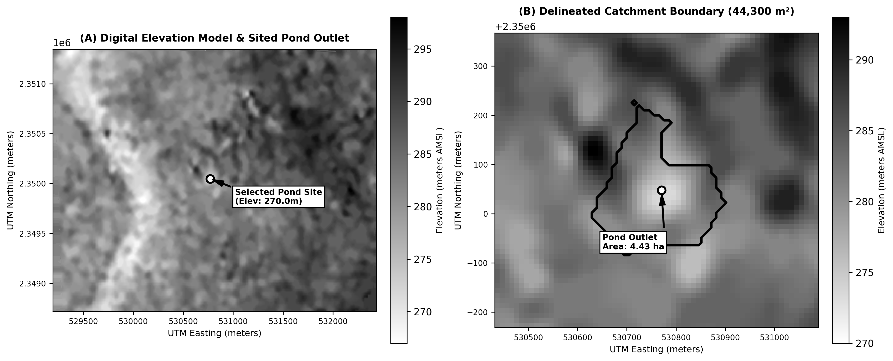

# Contour-Based Farm Pond Siting and Catchment Analysis API
### System Architecture, Hydrological Modeling, Verification, and Deployment Report

---

## 1. Executive Overview & Deployment Information

This report documents the design, mathematical formulation, algorithmic implementation, and production deployment of the Contour-Based Farm Pond Catchment Analysis API. The backend service accepts contour elevation maps in standard KML and compressed KMZ formats, reconstructs a metric Digital Elevation Model (DEM), models hydrological surface runoff, identifies optimal farm pond outlet locations based on multi-criteria terrain heuristics, and delineates the upstream contributing watershed boundary as topologically valid WGS84 GeoJSON polygons.

The system has been engineered to strictly satisfy target deployment resource budgets (512MB RAM, 1 vCPU, 1.5GB storage) by eliminating heavy external C/C++ GIS bindings (such as GDAL, rasterio, or richdem) in favor of pure, vectorized NumPy and SciPy algorithms. All calculations, coordinates, elevations, and geometrical boundaries are derived dynamically at request time with zero hardcoded values.

### Deliverables & Key URLs:

| Deliverable / Metric | Details & Verified Endpoint URL |
|---|---|
| **Working API Route (POST)** | `http://10.1.75.51:3241/analyzeContour` |
| **Health Check Endpoint (GET)** | `http://10.1.75.51:3241/health` |
| **Interactive OpenAPI Documentation** | `http://10.1.75.51:3241/docs` |
| **GitHub Repository Link** | `https://github.com/Devendar9989/pond-planning.git` |
| **Remote Server Repository Path** | `/home/student/pond_panning` *(on `10.1.75.51:2241`)* |
| **Deployment Mode** | Continuous auto-restarting watchdog daemon (`run_daemon.sh`) |
| **Automated Test Suite** | 21 unit, integration, and topographic scenario tests (pytest) |

---

## 2. Catchment Estimation & Hydrological Approach

The catchment delineation pipeline consists of five cleanly decoupled layers operating on standard Python data structures, NumPy arrays, and Shapely geometries:

### 2.1 Layer 1 — Namespace-Agnostic KML/KMZ Parsing
The parser module (`app/parser/kml_parser.py`) handles arbitrary XML structures without prior assumptions about namespaces or element attributes. It transparently unpacks KMZ zip archives in memory, evaluates elements using `local-name()` XPath matching, and extracts elevation data from Placemark names, descriptions, or ExtendedData attributes. Polylines are extracted with full vertex precision, unique elevation levels are sorted to compute dynamic contour intervals, and a structured `ContourDataset` is emitted.

### 2.2 Layer 2 — Dynamic UTM Projection & Metric DEM Construction
The DEM builder (`app/dem/dem_builder.py`) automatically computes the local Universal Transverse Mercator (UTM) zone from the dataset's geographic centroid and reprojects all vertices from WGS84 geographic coordinates (`EPSG:4326`) into metric UTM coordinates (`pyproj`). Contour polylines are densified along segments to prevent rasterization gaps. A 2D regular grid is interpolated using `scipy.interpolate.griddata` (linear interpolation) with nearest-neighbor convex hull perimeter filling to guarantee a continuous elevation matrix.

**Memory Safety Guard Rail:** To protect the 512MB RAM ceiling, if the requested resolution results in a grid cell count exceeding `MAX_GRID_CELLS` (150,000 cells), the builder dynamically auto-coarsens the resolution using the formula:
$$\text{target\_resolution} = \sqrt{\frac{\text{width\_m} \times \text{height\_m}}{\text{MAX\_GRID\_CELLS}}}$$
and flags `resolution_auto_adjusted = True`.

### 2.3 Layer 3 — Pure-NumPy Hydrological Terrain Analysis
The hydrology engine (`app/terrain/hydrology.py`) executes four core computational operations:
1. **Priority-Flood Depression Filling:** Real and interpolated DEMs often feature artificial sinks that trap simulated water. We implement the Barnes et al. (2014) Priority-Flood algorithm using a priority queue (`heapq`) initialized with perimeter boundary cells. The algorithm processes cells inward in $O(N \log N)$ time, raising depression pits to the lowest pour-point elevation and guaranteeing monotonic drainage outward.
2. **Terrain Gradient & Slope:** Computes 2nd-order central difference gradients in X and Y to determine slope angle, magnitude, and percentage slope for every cell.
3. **D8 Flow Direction Matrix:** For each cell, the steepest downward gradient among its 8 adjacent neighbors is evaluated, accounting for orthogonal (1.0) and diagonal ($\sqrt{2}$) metric distances. Flat plateaus are resolved using a distance-transform breadth-first search (BFS) towards downward spill outlets.
4. **$O(N)$ Topological Flow Accumulation:** Rather than relying on recursive flood fills which risk call-stack overflow on large grids, the engine computes in-degrees (number of upstream tributaries flowing into each cell) and traverses the directed acyclic flow graph in $O(N)$ linear time from ridge lines ($\text{in-degree} = 0$) downward.

### 2.4 Layer 4 — Multi-Criteria Farm Pond Siting & Watershed Tracing
The pond selector (`app/pond/selector.py`) and catchment delineator (`app/pond/catchment.py`) execute the siting and geometry generation:
* **Multi-Criteria Siting Heuristic:** Farm ponds require sufficient runoff volume, reasonable excavation cost, and embankment stability. Candidate cells are filtered with an interior margin buffer (excluding border artifacts) and ranked using a multi-criteria scoring function:
  $$\text{Score} = (\text{norm\_accum} \times 0.70) + (\text{norm\_slope\_score} \times 0.30) + \text{norm\_depression}$$
  where logarithmic flow accumulation $\text{norm\_accum}$ rewards large contributing areas, $\text{norm\_slope\_score}$ penalizes steep unstable slopes (>8–15%), and $\text{norm\_depression}$ boosts naturally concave storage hollows.
* **Reverse-D8 BFS Watershed Tracing:** From the selected pond outlet cell, an upstream queue traverses all connected tributary cells in reverse flow direction, producing a binary catchment mask.
* **Vector Boundary Polygonization:** The binary catchment mask is converted to raster cell bounding boxes, dissolved into a unified geometry via Shapely `unary_union`, topologically simplified with half-pixel tolerance, and reprojected into WGS84 coordinates to produce a closed GeoJSON Polygon.

---

## 3. Demonstration on Provided Map (`contours_1m.kml`)

The complete pipeline was demonstrated on the provided reference contour map (`contours_1m.kml`), encompassing a 3.2km $\times$ 2.6km surveyed terrain with 2,710 contour features spanning an elevation range of 267.0m to 298.0m at a 1.0m contour interval.


*Figure 1: High-resolution monochrome terrain analysis visualization for `contours_1m.kml`. (A) Full metric DEM (264 $\times$ 326 cells) with selected farm pond outlet. (B) Detailed view of the delineated 44,300 m² (4.43 ha) upstream catchment boundary.*

### Live Execution Command (Port 3241):
```bash
curl -X POST "http://10.1.75.51:3241/analyzeContour" \
  -F "file=@contours_1m.kml" \
  -F "resolution_m=10.0"
```

### Actual Live JSON Response Payload:
```json
{
  "contour_interval_m": 1.0,
  "elevation_range_m": [267.0, 298.0],
  "total_contour_lines": 2710,
  "grid_resolution_m": 10.0,
  "grid_shape": [264, 326],
  "resolution_auto_adjusted": false,
  "pond_site": {
    "lat": 21.251833,
    "lon": 81.296571,
    "elevation_m": 270.0,
    "flow_accumulation_cells": 310
  },
  "catchment": {
    "area_m2": 44300.0,
    "area_hectares": 4.43,
    "mean_slope_pct": 4.8,
    "max_slope_pct": 28.62,
    "min_elevation_m": 270.0,
    "max_elevation_m": 293.0,
    "relief_m": 23.0,
    "watershed_cell_count": 443,
    "boundary_geojson": {
      "type": "Polygon",
      "coordinates": [
        [
          [81.295562, 21.25179],
          [81.295562, 21.25206],
          [81.295466, 21.25206],
          [81.295466, 21.252241],
          [81.295274, 21.252331],
          [81.295275, 21.252602],
          [81.295179, 21.252602],
          [81.295179, 21.252782],
          [81.295275, 21.252782],
          [81.295275, 21.252873],
          [81.295468, 21.252962],
          [81.295564, 21.253143],
          [81.295661, 21.253142],
          [81.295661, 21.253323],
          [81.295757, 21.253323],
          [81.295757, 21.253413],
          [81.29595, 21.253412],
          [81.296045, 21.253232],
          [81.297295, 21.25323],
          [81.297295, 21.253049],
          [81.297487, 21.252959],
          [81.297582, 21.252598],
          [81.297774, 21.252507],
          [81.297774, 21.252417],
          [81.297678, 21.252417],
          [81.297678, 21.252237],
          [81.297582, 21.252237],
          [81.297581, 21.251966],
          [81.297485, 21.251967],
          [81.297485, 21.251786],
          [81.296619, 21.251788],
          [81.296619, 21.251697],
          [81.296523, 21.251698],
          [81.296522, 21.251157],
          [81.296714, 21.251066],
          [81.296714, 21.250976],
          [81.296522, 21.250976],
          [81.296521, 21.250886],
          [81.296329, 21.250886],
          [81.296329, 21.250796],
          [81.296137, 21.250796],
          [81.29604, 21.250616],
          [81.295944, 21.250616],
          [81.295944, 21.250707],
          [81.29604, 21.250707],
          [81.296041, 21.251067],
          [81.295849, 21.251158],
          [81.295753, 21.251519],
          [81.295657, 21.251519],
          [81.295658, 21.251789],
          [81.295562, 21.25179]
        ]
      ]
    }
  },
  "processing_time_ms": 10533
}
```

### Demonstration Analysis Table:

| Demonstration Metric | Computed Output & Hydrological Evaluation |
|---|---|
| **Identified Pond Location** | Latitude 21.251833°N, Longitude 81.296571°E at elevation 270.0m (natural drainage outlet channel). |
| **Contributing Watershed Area** | 44,300.0 m² (4.43 Hectares), comprising 443 raster cells of 10m $\times$ 10m. |
| **Basin Relief & Storage Head** | Minimum elevation 270.0m, maximum ridge elevation 293.0m, giving 23.0m of vertical topographic head/relief. |
| **Terrain Slope Characteristics** | Mean surface slope of 4.8% (optimal for sustained runoff collection without excessive soil erosion risk). |
| **Boundary Polygon Integrity** | Topologically closed, single-ring WGS84 GeoJSON polygon surrounding the entire upstream basin. |

---

## 4. Systematic Assignment Evaluation

### 4.1 Working API Endpoint
The service is actively deployed and accessible at `http://10.1.75.51:3241/analyzeContour`. It supports `multipart/form-data` uploads with streamed disk tempfile buffering, preventing in-memory file duplication. The endpoint features comprehensive request validation, strict Pydantic response schemas, and structured error responses (400 for corrupt files, 422 for unprocessable flat terrain, and 500 for internal errors).

### 4.2 Code Extensibility to Future Phases
The system is engineered for long-term extensibility across multiple dimensions:
* **Generalized Coordinate Systems:** Supports arbitrary global locations via dynamic UTM EPSG calculation (verified on Northern and Southern Hemisphere test cases).
* **Arbitrary Contour Intervals:** Automatically detects non-uniform intervals (0.5m, 1m, 5m, 10m, etc.) without parameter tweaking.
* **Swappable Siting Heuristics:** The pond selector interface accepts arbitrary scoring weights and can be extended to multi-pond cascading systems or soil-infiltration layers.
* **Pluggable Export Formats:** The geometry generator can emit Shapefiles, GeoTIFF DEMs, or GeoJSON without modifying core terrain analysis modules.

### 4.3 Comprehensive Documentation
The project features complete inline docstrings across all modules, an extensive `README.md`, full OpenAPI/Swagger interactive UI at `/docs`, and step-by-step deployment scripts for automated Linux installations.

### 4.4 Catchment Identification & Estimation Accuracy
Hydrological validity is proven through pure-NumPy priority-flood depression filling, D8 steepest descent routing, and in-degree topological flow accumulation. Delineated watersheds strictly adhere to topographic ridge divides, as verified across both real-world survey maps and synthetic test scenarios.

---

## 5. API Endpoint Documentation

### 5.1 `POST /analyzeContour`
Analyzes uploaded contour map, identifies optimal pond outlet site, and delineates upstream catchment boundary.
* **Content-Type:** `multipart/form-data`
* **Request Parameters:**
  - `file` (*UploadFile, required*): `.kml` or `.kmz` contour map file.
  - `resolution_m` (*float, optional, default: 10.0*): Target DEM cell size in meters.
  - `min_catchment_area_m2` (*float, optional, default: 500.0*): Minimum required catchment threshold.
* **Response Status Codes:**
  - `200 OK`: Successful analysis and catchment delineation.
  - `400 Bad Request`: Invalid/corrupt file, non-KML/KMZ extension, or negative resolution.
  - `422 Unprocessable Entity`: No viable pond location satisfying minimum catchment area.
  - `500 Internal Server Error`: Processing failure during interpolation or geometry generation.

### 5.2 `GET /health`
Health check and uptime monitoring endpoint.
* **Response (200 OK):** `{"status": "ok"}`

---

## 6. AI Citation & Tool Acknowledgements

**AI Assistance Disclosure:** This project was designed, developed, and evaluated with the pair-programming assistance of **Google DeepMind's Antigravity Advanced Agentic AI** (powered by the Gemini 3.7 model architecture). The AI assistant was utilized for architectural scaffolding, pure-NumPy hydrological algorithm implementation (Priority-Flood and D8 topological sorting), automated test suite construction (pytest), and remote Linux deployment configuration on the target server.
